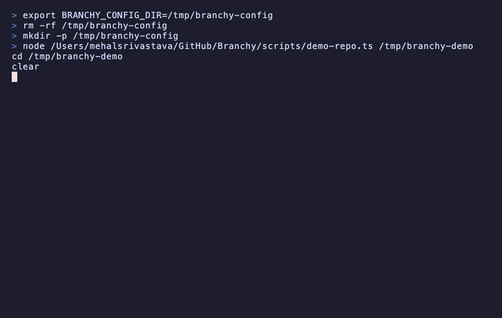

# Branchy

**Git flow without the command flow.**

A fast, safe, keyboard-first terminal UI for the Git you do every day — switch
branches, create branches, fetch, and drive commits without command archaeology.
Branchy shows you the underlying Git command before it runs, and treats
destructive operations with care.



```
╭──────────────────────────────────────────────────────────────────────────╮
│ branchy  payments-api                                          main ↑2    │
╰──────────────────────────────────────────────────────────────────────────╯

 Repository  main → origin/main   changes

 0 staged   1 modified   1 untracked

 Quick actions
 [b] Switch branch                     [c] Conventional commit
 [n] New branch                        [s] Sweep merged branches
 [f] Fetch remote                      [p] Prepare PR

 Recent branches
 ● main                                                         ↑2  1s
   fix/old-header                                       remote gone  1s
   feat/payment-retry                                            ↑1  1s
   experiment/cache                                     no upstream  1s

 • Suggested: Stage changes and commit  (press c)

 b switch  n new  f fetch  c commit  s sweep  : commands  ? help  q quit
```

> This is a **real rendered frame**, not a mockup.

## Why

You already know `git switch`, `git branch --merged`, `git commit`. The friction
isn't knowledge — it's remembering exact branch names, telling local from remote,
knowing whether a branch is safe to delete, and repeating the same sequences all
day. Branchy removes that friction while keeping Git transparent.

## Install

Requires **Node ≥ 18** and **Git ≥ 2.23** (for `git switch`).

```bash
# from source (pre-release)
git clone <repo> branchy && cd branchy
npm install && npm run build
node dist/cli.js            # or: npm link  → then `branchy`
```

> `npm install -g branchy` will be the install path once the package name is
> verified and published.

## 30-second quick start

```bash
cd your-repo
branchy            # opens the dashboard
```

- Press **`b`**, type a few characters (`payret` finds `feat/payment-retry`),
  hit **Enter** — you're switched.
- Press **`n`** to create a well-named branch from a type + description.
- Press **`f`** to fetch, **`r`** to refresh, **`:`** for the command palette.
- Press **`?`** anytime for contextual help.

Not in a TTY? Branchy stays useful:

```bash
branchy status           # short human summary
branchy status --plain   # key=value output for scripts
branchy switch <branch>  # non-interactive switch
branchy config           # show resolved configuration and its sources
branchy doctor           # environment diagnostics (safe to paste in bug reports)
```

## Key workflows

| Key | Action | Status |
| --- | --- | --- |
| `b` | Fuzzy branch switcher (local + remote, details, previews) | ✅ |
| `n` | New branch (type + description → safe name) | ✅ |
| `f` | Fetch remote | ✅ |
| `r` | Refresh repository state | ✅ |
| `s` | Sweep merged branches (classify, safe `-d` delete, **undo**) | ✅ |
| `c` | Conventional commit (staging, type/scope/subject, checks, hooks) | ✅ |
| `p` | PR readiness (checklist, push, compare URL, `gh` detect) | ✅ |
| `:` | Fuzzy command palette | ✅ |
| `?` | Contextual help | ✅ |

## Safety philosophy

- **No shell strings.** Every Git call is an argument array run with
  `shell: false`; refs are guarded with `--`.
- **No silent stashing.** A dirty-tree switch asks first and shows the exact
  commands. Partial failures are reported honestly.
- **Merged means merged.** Deletion safety uses Git ancestry, never branch names
  or age.
- **Transparent.** Command previews are on by default.

See [docs/git-safety.md](docs/git-safety.md).

## Configuration

Layered TOML config: **built-in defaults → `~/.config/branchy/config.toml`
(user) → `.branchy.toml` (repo) → CLI flags**. Invalid files are reported with a
precise `file:field — message` and skipped — never fatal. Run `branchy config`
to see the resolved result and where each value came from.

```toml
# .branchy.toml
[ui]
command_preview = true
theme = "default"          # or "none" for no color

[branches]
default_base = "main"      # override base detection
protected = ["main", "release/*"]

[commit]
scopes = ["cli", "git", "ui"]
max_subject_length = 72
require_scope = false

[checks]
# Pre-commit checks. Repo-defined commands require explicit trust before they
# run (Branchy re-prompts if the set changes). Omit to auto-detect npm scripts.
commands = ["npm run typecheck", "npm test"]
```

See [`.branchy.example.toml`](.branchy.example.toml) for the fully annotated set
of options, and [docs/git-safety.md](docs/git-safety.md) for the check trust
model.

## Development

```bash
npm install
npm run dev          # run the TUI from source (tsx)
npm test             # unit + real-git integration + TUI tests
npm run typecheck
npm run demo:repo    # generate a demo repo with varied branch states
npm run build        # bundle to dist/ (tsup)
```

Docs: [architecture](docs/architecture.md) ·
[git safety](docs/git-safety.md) · [testing](docs/testing.md) ·
[ADR 001](docs/adr/001-technology-stack.md) · [progress](docs/progress.md)

## Roadmap

Stale-branch sweeper with undo → conventional commits with pre-commit checks →
PR readiness with optional GitHub CLI integration → config system → diff viewer.
Tracked in [docs/progress.md](docs/progress.md).

## Troubleshooting

- **"branchy is interactive and needs a TTY"** — you're piping output; use
  `branchy status --plain`.
- **Nothing happens on launch** — run `branchy doctor` to check Git and repo
  detection.

## License

[MIT](LICENSE) — the conventional default for a tool like this. Change it if the
project owner prefers otherwise before publishing.
