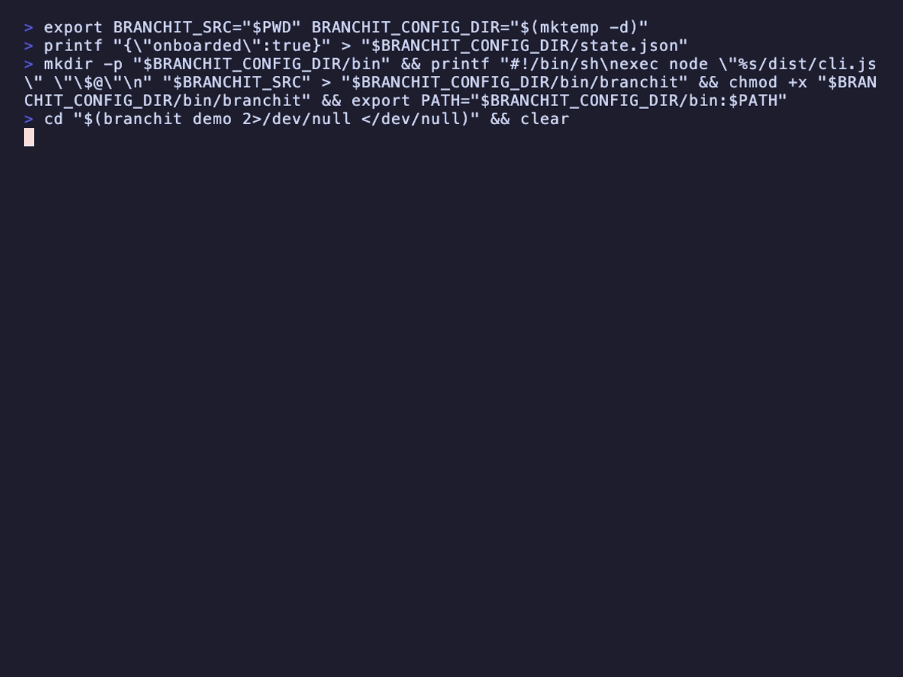

# 🌿 branchit

[](https://www.npmjs.com/package/branchit)
[](https://github.com/MeHalogen/branchit/actions)
[](LICENSE)
[](package.json)

**Git with an undo button.** A fast, safe, keyboard-first terminal UI for the
Git you do every day: switch, commit, clean up branches, juggle worktrees —
and take any of it back.


## Try it in one line

```bash
npx branchit demo
```

Opens Branchit in a throwaway sandbox repository with merged, squash-merged,
stale and remote-gone branches. Nothing touches your own repositories.

```bash
npx branchit sweep
```

In any repository: see your dead branches, ending with a one-line report you
can paste anywhere:

```
14 branches · 9 safely merged · 2 likely squash-merged · 1 upstream gone · oldest 13 months
```

`branchit sweep --yes` deletes only the branches proven merged.

```bash
branchit undo
```

Changed your mind? Shows the last operation and the exact inverse commands;
`--yes` runs them.

## What it does

| Key | Feature | Undoable |
| --- | --- | --- |
| `b` | Fuzzy branch switcher with a preview of where you are jumping | ✓ |
| `n` | New branch from a prefix and a description | ✓ |
| `c` | Conventional commit wizard: stage files, type, scope, subject, trusted pre-commit checks, optional AI message (`ctrl+g`) | ✓ (soft reset, changes stay staged) |
| `w` | Working tree and diff viewer: stage files or single hunks, discard | ✓ discard |
| `s` | Sweeper: merged / squash-merged / gone branches, by ancestry, never by age | ✓ |
| `y` | Pull with an explicit fast-forward / merge / rebase choice; stops on conflicts with a one-key abort | ✓ |
| `z` | Stash manager: preview, apply, pop, drop, stash → branch | ✓ drop |
| `t` | Worktree manager: dirty state, ahead/behind, add, remove, prune, open in your shell | ✓ |
| `p` | PR readiness: checklist, push with upstream, compare link | pushes are never undone |
| `u` | Undo the last operation, after showing exactly what will run | — |
| `/` | Search branches, commands, commits and files in one box | — |
| `:` | Command palette, including *Recover lost work* (reflog time machine) | — |


### Worktrees for parallel work

Run several branches — or several coding agents — side by side without
re-cloning. `t` lists every worktree with its state; new ones land in
`../{repo}-wt/{branch}` (configurable). Add the shell integration once and
`enter` on a worktree leaves Branchit with your shell already in it:

```bash
eval "$(branchit shell-init zsh)"   # or bash; fish: branchit shell-init fish | source
```



## Install

```bash
npm install -g branchit
```

Requires **Node ≥ 18** and **Git ≥ 2.23**. Then run `branchit` in any
repository. Shell completions: `branchit completions zsh|bash|fish`.

## Commands

Everything the TUI does to inspect state is also scriptable, with `--json`:

| Command | Description |
| --- | --- |
| `branchit` | Open the interactive TUI |
| `branchit demo` | Open the TUI in a sandbox repository |
| `branchit sweep [--yes] [--json]` | List stale branches; `--yes` deletes the safely merged ones |
| `branchit undo [--yes] [--list] [--json]` | Preview or apply the inverse of the last operation |
| `branchit worktrees [--json]` | Worktrees with dirty state and ahead/behind (alias `wt`) |
| `branchit branches [--all] [--json]` | Branches with upstream state |
| `branchit pr [--json]` | Pull-request readiness for the current branch |
| `branchit status [--plain\|--json]` | Repository status for scripts |
| `branchit switch <name>` | Switch non-interactively |
| `branchit config` · `doctor` | Resolved configuration · environment diagnostics |
| `branchit completions <shell>` · `shell-init <shell>` | Completions · cd-on-exit wrapper |

## How it compares

[lazygit](https://github.com/jesseduffield/lazygit) and
[gitui](https://github.com/extrawurst/gitui) are excellent, mature tools, and
you may well be happier with one of them:

- **lazygit** covers far more Git: interactive rebase, cherry-pick, bisect,
  custom commands and a much larger community. Its undo works through the
  reflog; Branchit keeps its own journal so it can also reverse branch
  deletions, stash drops, discards and worktree changes, and shows the
  commands before running them.
- **gitui** is very fast and lightweight, written in Rust.
- **Branchit** is deliberately narrower: everyday flows, every mutation
  previewed and undoable, branch cleanup grounded in ancestry, first-class
  worktrees, and a scriptable `--json` CLI next to the TUI.

## Safety

- Every Git call uses argument arrays with `shell: false`; refs sit behind
  `--`. Configured commands (checks, `[ai]`) are split into arguments without
  ever touching a shell.
- Nothing is stashed, deleted or force-removed silently. Destructive actions
  show the exact command and need a confirm; force actions are red.
- Repository-defined commands (pre-commit checks, the AI command) never run
  until you trust that exact command set; changing it asks again.
- Branch deletion is decided by Git ancestry and patch equivalence, never by
  name or age. Pushes are never "undone" by rewriting shared history.

More in [docs/git-safety.md](docs/git-safety.md).

## Configuration

Settings layer: built-in defaults → `~/.config/branchit/config.toml` →
`.branchit.toml` in the repository. Invalid files are reported precisely and
skipped. `branchit config` shows the result and where each value came from.

```toml
[ui]
theme = "catppuccin"          # default, catppuccin, tokyo-night, gruvbox, none

[branches]
default_base = "main"
protected = ["main", "release/*"]

[commit]
scopes = ["cli", "api"]
max_subject_length = 72

[checks]
commands = ["npm run typecheck", "npm test"]

[worktrees]
root = "../{repo}-wt/{branch}"

[keys]
sweep = "x"                   # rebind dashboard keys by command name

[ai]
# Any program that reads a diff on stdin and prints a commit message.
command = "llm -s 'Write a conventional commit message for this diff.'"
```

See [`.branchit.example.toml`](.branchit.example.toml) for every option.

## Learn more

- [Understanding Git better with Branchit](docs/learn-git.md) — branches,
  staging, upstreams, sweeping, undo and worktrees explained
- [Architecture](docs/architecture.md) · [Testing](docs/testing.md) ·
  [Contributing](CONTRIBUTING.md) · [Changelog](CHANGELOG.md)

## License

[MIT](LICENSE)
